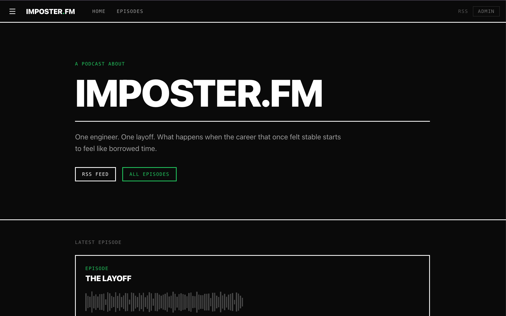

# imposter.fm

`imposter.fm` is a podcast website + admin CMS built with TanStack Start.

## What the app does

- Serves a public podcast site (homepage latest episode, archive, detail, embed widget)
- Generates a podcast RSS feed at `/rss.xml`
- Streams audio through `/api/stream/:episodeId` with range request support
- Generates per-episode Open Graph images (`/api/og/episode/:slug`)
- Provides a persistent mini player that continues across route navigation
- Saves listener playback preferences (`speed`, `volume`) in local storage
- Tracks listens with a lightweight endpoint (`POST /api/listen`)
- Includes admin auth + episode management (create, edit, publish, delete)
- Supports both uploading audio files and recording audio directly in-app
- Supports admin password changes (`/admin/password`)

## Tech stack

- TanStack Start + TanStack Router + React 19
- TanStack Query + tRPC
- Drizzle ORM + PostgreSQL
- Better Auth (email/password)
- Tailwind CSS v4
- Biome (lint/format)
- Optional PostHog analytics

## Requirements

- Bun
- PostgreSQL

## Environment variables

Create `.env.local` in the project root.

Required:

- `DATABASE_URL` - PostgreSQL connection string
- `BETTER_AUTH_SECRET` - Better Auth secret

Optional admin bootstrap values:

- `ADMIN_EMAIL` (default `admin@imposter.fm`)
- `ADMIN_PASSWORD` (default `changeme123`)
- `ADMIN_NAME` (default `Admin`)

Optional frontend/site values:

- `VITE_SITE_URL` - canonical site URL used for metadata/share links

Optional analytics values:

- `VITE_POSTHOG_KEY` - PostHog project key (`phc_...`)
- `VITE_POSTHOG_HOST` - defaults to `https://us.i.posthog.com`

Optional production object storage values (S3 or R2 compatible):

- `S3_BUCKET_NAME` or `R2_BUCKET_NAME`
- `S3_ENDPOINT` or `R2_ENDPOINT`
- `S3_REGION` (defaults to `auto`)
- `S3_ACCESS_KEY_ID` or `R2_ACCESS_KEY_ID`
- `S3_SECRET_ACCESS_KEY` or `R2_SECRET_ACCESS_KEY`

Storage behavior:

- Development uses local uploads at `./uploads` via `/api/upload`
- Production uses S3/R2 signed upload URLs

## Local development

1. Install dependencies:

```bash
bun install
```

2. Create `.env.local` with required values.

3. Push schema to database:

```bash
bun run db:push
```

4. Create an initial admin user:

```bash
bunx tsx scripts/create-admin.ts
```

5. Start dev server:

```bash
bun run dev
```

App URL: `http://localhost:3000`

Admin login: `/login`

## Scripts

```bash
bun run dev
bun run build
bun run start
bun run preview
bun run test
bun run lint
bun run format
bun run check
bun run db:generate
bun run db:migrate
bun run db:push
bun run db:pull
bun run db:studio
```

## Important routes

Public:

- `/`
- `/episodes`
- `/episodes/:slug`
- `/embed/:slug`
- `/rss.xml`

Admin:

- `/login`
- `/admin`
- `/admin/episodes`
- `/admin/episodes/new`
- `/admin/episodes/:id/edit`
- `/admin/password`

API:

- `/api/stream/:episodeId`
- `/api/listen`
- `/api/upload` (development local upload target)
- `/api/og/episode/:slug`
- `/api/trpc/*`

## Notes

- RSS feed falls back to defaults if no podcast settings row exists.
- PostHog initialization is skipped when key is missing or placeholder (`phc_xxx`).
